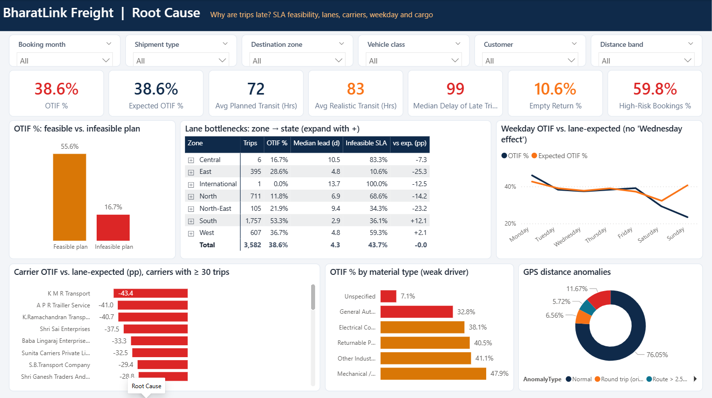
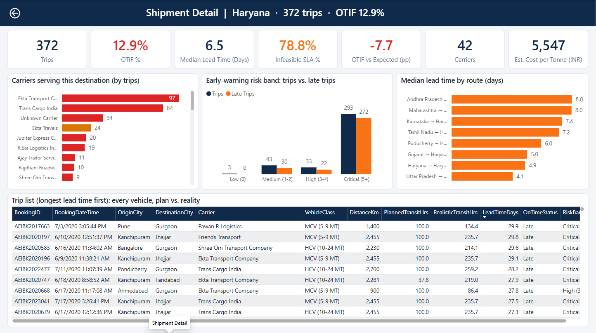

# Power BI Build Guide: BharatLink Freight OTIF

This folder contains a **Power BI Project (PBIP)**: `Transport_Logistics_OTIF.pbip`, with the semantic model in TMDL (`Transport_Logistics_OTIF.SemanticModel/`) and the report in PBIR (`Transport_Logistics_OTIF.Report/`). It is plain text, so it is diff-able and Git-friendly, and it opens directly in Power BI Desktop.

## 1. Open & refresh (2 minutes)

1. Install / update **Power BI Desktop** (tested on version 2.153, April 2026).
2. Double-click **`Transport_Logistics_OTIF.pbip`**.
3. If the project folder is **not** at the original path, go to **Transform data → Edit parameters → `DataFolder`** and paste the full path of `02_Data/processed/` (it must end with a backslash `\`).
4. Click **Refresh** (or *Refresh now* on the yellow banner). All visuals fill with data.
5. Optional: **File → Save as → .pbix** if you need a single file to share or publish.

> The CSVs are typed with the `en-US` culture inside Power Query, so decimals load correctly on any regional setting (including Vietnamese).

## 2. Data model (star schema)

| Table | Role | Source file |
|---|---|---|
| `fact_trips` | Fact | `fact_trips.csv` |
| `dim_carrier` | Dimension | `dim_carrier.csv` |
| `dim_customer` | Dimension | `dim_customer.csv` |
| `dim_zone` | Dimension | `dim_zone.csv` |
| `dim_date` | Dimension | `dim_date.csv` |
| `_Measures` | Measure table (no data) | - |

**Relationships** (all single-direction, many-to-one):

- `fact_trips.BookingDay` → `dim_date.Date`
- `fact_trips.CarrierKey` → `dim_carrier.CarrierKey`
- `fact_trips.CustomerKey` → `dim_customer.CustomerKey`
- `fact_trips.DestinationZone` → `dim_zone.DestinationZone`

## 3. DAX measures

All measures live in the `_Measures` table, organised in display folders.


### 1. Delivery (OTIF)

**Trips**
```dax
Trips =
COUNTROWS ( fact_trips )
```
**On-time Trips**
```dax
On-time Trips =
SUM ( fact_trips[IsOnTime] )
```
**Late Trips**
```dax
Late Trips =
[Trips] - [On-time Trips]
```
**OTIF %**: On-time share of trips (no in-full quantity in the data).
```dax
OTIF % =
DIVIDE ( [On-time Trips], [Trips] )
```
**Late Rate %**
```dax
Late Rate % =
1 - [OTIF %]
```
**OTIF Target (+5 pp)**: Baseline 38.6% + 5 pp next-quarter target.
```dax
OTIF Target (+5 pp) =
IF ( NOT ISBLANK ( [Trips] ), 0.436 )
```

### 5. UI Helpers

**OTIF Color**
```dax
OTIF Color =
SWITCH ( TRUE (), [OTIF %] >= 0.6, "#16A34A", [OTIF %] >= 0.35, "#D97706", "#DC2626" )
```

### 2. Lead time & SLA

**Avg Lead Time (Days)**
```dax
Avg Lead Time (Days) =
CALCULATE ( AVERAGE ( fact_trips[LeadTimeDays] ), fact_trips[ValidLeadTime] = 1 )
```
**Median Lead Time (Days)**
```dax
Median Lead Time (Days) =
CALCULATE ( MEDIAN ( fact_trips[LeadTimeDays] ), fact_trips[ValidLeadTime] = 1 )
```
**Median Delay of Late Trips (Hrs)**
```dax
Median Delay of Late Trips (Hrs) =
CALCULATE ( MEDIAN ( fact_trips[DelayHrs] ), fact_trips[IsOnTime] = 0, fact_trips[ValidLeadTime] = 1 )
```
**Avg Planned Transit (Hrs)**
```dax
Avg Planned Transit (Hrs) =
AVERAGE ( fact_trips[PlannedTransitHrs] )
```
**Avg Realistic Transit (Hrs)**: Distance / 250 km per day (dataset policy).
```dax
Avg Realistic Transit (Hrs) =
AVERAGE ( fact_trips[RealisticTransitHrs] )
```
**Infeasible SLA %**: Share of trips whose planned ETA implies > 250 km/day.
```dax
Infeasible SLA % =
1 - AVERAGE ( fact_trips[SLAFeasible] )
```
**Total Distance (km)**
```dax
Total Distance (km) =
SUM ( fact_trips[DistanceKm] )
```

### 3. Carrier benchmarking

**Expected OTIF %**: Network on-time rate for the same distance band & SLA feasibility.
```dax
Expected OTIF % =
AVERAGE ( fact_trips[ExpectedOnTime] )
```
**OTIF vs Expected (pp)**
```dax
OTIF vs Expected (pp) =
( [OTIF %] - [Expected OTIF %] ) * 100
```
**Carriers**
```dax
Carriers =
DISTINCTCOUNT ( fact_trips[CarrierKey] )
```

### 4. Utilisation, anomalies & cost

**Empty Return %**
```dax
Empty Return % =
AVERAGE ( fact_trips[IsEmptyReturn] )
```
**GPS Anomaly %**
```dax
GPS Anomaly % =
DIVIDE ( CALCULATE ( [Trips], fact_trips[AnomalyType] <> "Normal" ), [Trips] )
```
**High-Risk Bookings %**: Share of bookings with early-warning score >= 3.
```dax
High-Risk Bookings % =
DIVIDE ( CALCULATE ( [Trips], fact_trips[RiskScore] >= 3 ), [Trips] )
```
**Est. Freight Cost (INR M)**: Modelled: distance x assumed rate card.
```dax
Est. Freight Cost (INR M) =
DIVIDE ( SUM ( fact_trips[EstFreightCostINR] ), 1000000 )
```
**Est. Cost per Tonne (INR)**
```dax
Est. Cost per Tonne (INR) =
DIVIDE ( SUM ( fact_trips[EstFreightCostINR] ), SUM ( fact_trips[CapacityUsedMT] ) )
```

### 5. UI Helpers

**Carrier Color**
```dax
Carrier Color =
SWITCH ( TRUE (), [OTIF vs Expected (pp)] <= -15, "#DC2626", [OTIF vs Expected (pp)] >= 15, "#16A34A", "#94A3B8" )
```
**Avg Dest Latitude**
```dax
Avg Dest Latitude =
AVERAGE ( fact_trips[DestLat] )
```
**Avg Dest Longitude**
```dax
Avg Dest Longitude =
AVERAGE ( fact_trips[DestLon] )
```
**Selected State**
```dax
Selected State =
SELECTEDVALUE ( fact_trips[DestinationState], "All destinations" )
```
**Drill Title**
```dax
Drill Title =
"Shipment Detail  |  " & [Selected State] & "  ·  " & FORMAT ( [Trips], "#,0" ) & " trips  ·  OTIF " & FORMAT ( [OTIF %], "0.0%" )
```

## 4. Report pages


| Page | Question it answers | Visuals |
|---|---|---|
| **1. Network Overview** | *How healthy is delivery?* | 6 slicers (booking month, shipment type, destination zone, vehicle class, customer, distance band) · 7 KPI cards · trips & OTIF by month (core period) vs. +5 pp target · OTIF by distance band · **GPS hot-spot map** (scatter of destination lat/long, size = trips, colour = OTIF; works offline, with no map tiles) · OTIF by destination zone · key insights |
| **2. Root Cause** | *Why are trips late?* | 7 KPI cards · OTIF for feasible vs. infeasible plans · zone → state lane matrix (expand +) · weekday OTIF vs. lane-expected · carrier OTIF vs. lane benchmark (pp, ≥ 30 trips, red / green by verdict) · OTIF by material · GPS anomaly mix |
| **3. Shipment Detail** *(drill-through, field `fact_trips[DestinationState]`)* | *Which trucks, exactly?* | Dynamic title · back button · 7 KPI cards · carriers serving the state · early-warning risk band (trips vs. late) · median lead time by route · **trip list** (every booking: plan vs. realistic transit, lead time, status, risk band) |

**Drill-through (region → shipment):** on page 1 or 2, right-click a zone or state → **Drill through → Shipment Detail**. The page opens on *Haryana* as a demo state.

**Why a scatter "map"?** The Bing / Azure map visuals are disabled by default in many tenants and need internet tiles. Plotting longitude (X) against latitude (Y) gives a reliable, offline map of India. If your tenant allows it, you can swap in an *Azure Map* visual using `DestLat` / `DestLon`.






## 5. Rebuilding by hand (if you prefer a .pbix from scratch)

1. **Get data → Text/CSV**, load every file in `02_Data/processed/`.
2. In **Model view**, create the relationships listed above; mark `dim_date` as a date table (column `Date`).
3. Set **Sort by column**: `MonthName` → `MonthNo`, `DayName` → `DayOfWeekNo`, `YearMonth` → `MonthStart`.
4. Create a blank table `_Measures` and paste the DAX measures above.
5. Apply the theme: **View → Themes → Browse** → `Transport_Logistics_OTIF.Report/StaticResources/RegisteredResources/*.json`.
6. Build the pages following section 4 (canvas 1280 × 720, 16:9).
