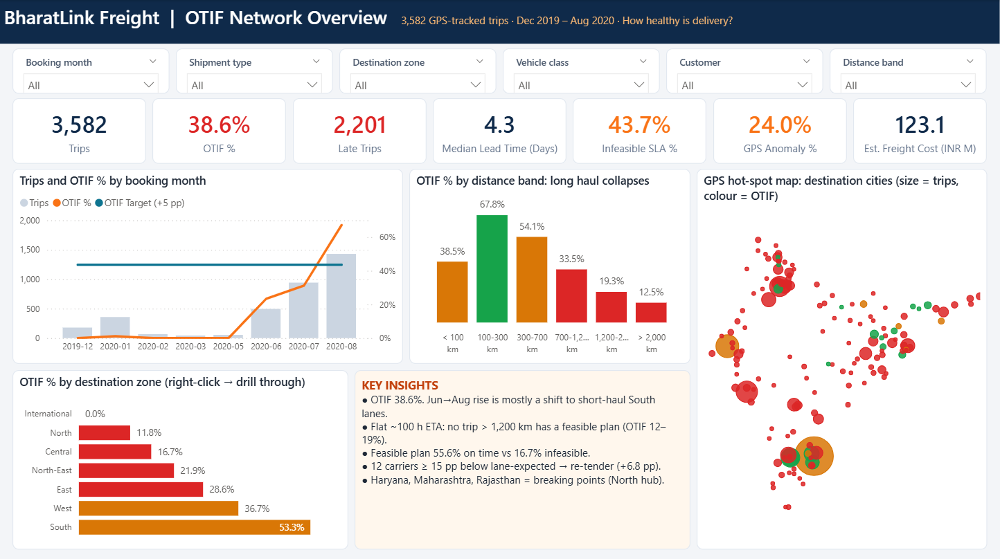

# 🚚 Transportation & Logistics Analytics: Fixing OTIF at BharatLink Freight

[](03_Python/Transport_Logistics_OTIF_Analysis.ipynb)
[](04_PowerBI/PowerBI_Build_Guide.md)
[](https://haven-portfolio02.vercel.app/?scroll=projects)
[](https://github.com/Haven-Pham)

> **TL;DR:** Network OTIF is only **38.6%**, mainly because a flat 100-hour ETA makes **0% of trips over 1,200 km feasible**. Re-tendering 12 weak carriers plus a booking-time early-warning score (**72% precision / 82% recall** out-of-time) targets about **+11.8 pp OTIF**.



## 🎯 1. Context & Objectives

BharatLink Freight (fictional) runs full-truck-load road freight for automotive and industrial OEMs across India. Deliveries are late, costs are not optimised and carrier performance varies widely. This project analyses **3,582 GPS-tracked bookings** (Dec 2019 – Aug 2020) to answer the Board's **10 golden questions**. It finishes with **3 actions that lift OTIF by ≥ 5 pp next quarter**.

## 🗂️ 2. Repository Structure

```
Project 2 - Transportation and Logistics Analytics/
├── 01_Problem_Statement/   Problem_Statement_Transport_Logistics.docx
├── 02_Data/
│   ├── raw/                Transportation & Logistics Tracking Dataset.xlsx
│   └── processed/          fact_trips + dim_carrier, dim_customer, dim_zone, dim_date (CSV)
├── 03_Python/              Transport_Logistics_OTIF_Analysis.ipynb
│   └── outputs/            data_quality_log, carrier_scorecard, route_bottlenecks, state_breaking_points, monthly_otif, metrics.json
├── 04_PowerBI/             Transport_Logistics_OTIF.pbip (+ .Report / .SemanticModel), PowerBI_Build_Guide.md, screenshots/
└── 05_Presentation/        BharatLink_OTIF_Turnaround.pptx  (21-slide board deck)
```

## 💻 3. Tech Stack

* **Python** 🐍: `pandas`, `numpy` (cleaning, feature engineering) · `scipy` (χ² / Cramér's V) · `plotly` (EDA + offline geo map) · Jupyter
* **Power BI** 📊: Power Query, star schema, **27 DAX measures**, PBIP / TMDL / PBIR, region → shipment drill-through, GPS scatter map
* **PowerPoint**: board storytelling with native, editable charts

**Run it:** open the notebook and *Run All*, then open `04_PowerBI/Transport_Logistics_OTIF.pbip` and click **Refresh**.

## 🧹 4. Data Cleaning Highlights

This is a messy operational export:
- **Mixed-type date columns** with Excel's `1899-12-30` used as a placeholder.
- **Duplicated booking IDs.**
- **152 / 353 inconsistent** origin / destination spellings.
- **712 free-text material descriptions**, mapped to 6 categories with keyword rules.
- **21% missing vehicle type.**
- **79 implausible lead times** (stale GPS closures).
- **PII** (driver names and phones), which was dropped.

The brief also asks for *in-full*, *weight* and *freight cost*, none of which exist in the data:
- **OTIF = on-time.**
- **Utilisation and cost** use clearly labelled proxies: empty-return trips, vehicle capacity, and an adjustable INR/km rate card.

## 💡 5. Key Insights (10 Golden Questions)

| # | Question | Finding |
|---|---|---|
| 1 | OTIF health | **38.6%** network OTIF. The rise from 23% to 67% (Jun → Aug 2020) is mostly a **mix shift** to short South lanes. |
| 2 | Bottlenecks | A **flat ~100-hour ETA ignores distance**: **0% of trips > 1,200 km get a feasible plan** (OTIF 12–19%). A feasible plan is **55.6%** on time vs **16.7%** when infeasible. Short-haul suffers from **site dwell** (UP, Odisha: 6+ days for < 70 km). |
| 3 | Carriers | Benchmarked against the lane-expected rate: **12 carriers ≥ 15 pp below → re-tender** (about 800 trips). Ekta and Trans Cargo look bad but perform as expected on 2,000 km lanes. |
| 4 | Material | Significant but weak (Cramér's V 0.12 vs 0.40 for SLA feasibility). |
| 5 | Utilisation | **10.6%** of trips are empty-packaging returns; **55%** of 25–35 MT trailer trips are < 100 km shuttles. |
| 6 | GPS anomalies | **24%** of trips: impossible routes (11.7%), detours (5.7%) or round trips (6.6%). |
| 7 | Weekday | **No "Wednesday effect"** (−0.3 pp vs expected). The weak spot is **weekend long-haul**. |
| 8 | Cost (modelled) | The **North costs ≈ 5×** the South per tonne, takes 34% of spend and has the worst OTIF (11.8%). |
| 9 | Breaking points | **Haryana, Maharashtra, Rajasthan** → SLA + North hub. **West Bengal, Odisha** → dual-source carrier. |
| 10 | Early warning | A 4-rule score: **precision 72% / recall 82%** on an out-of-time test (Aug-2020). |

## 🚀 6. Recommendations (next quarter, target ≥ +5 pp OTIF)

1. **Re-tender the 12 weakest carriers** and shift volume to 9 preferred ones: **+6.8 pp**.
2. **Deploy the booking-time early-warning score** in customer service and dispatch: **+5.0 pp** at a conservative 10% recovery rate.
3. **Replace the flat 100-hour ETA with a distance-based SLA** (250 km/day + buffer) and fix the GPS master data. This re-baselines measured OTIF by **+15.6 pp** and restores customer trust.

➡️ Levers 1 + 2 alone deliver about **+11.8 pp**. Next step: a **North cross-dock** feasibility study.

## 📊 7. Dashboard

| Page | Purpose |
|---|---|
| Network Overview | KPI cards, monthly OTIF, OTIF by distance, GPS hot-spot map, OTIF by zone |
| Root Cause | SLA feasibility, lane matrix, weekday vs. expected, carrier benchmark, material, GPS anomalies |
| Shipment Detail (drill-through) | Region → carriers, risk bands, routes and every truck |

## 📁 8. Data & privacy

BharatLink Freight is a **fictional company**; the tracking data comes from the course brief.

- The **raw Excel export is not committed** because it contains driver names and mobile numbers. To re-run the notebook, place `Transportation & Logistics Tracking Dataset.xlsx` in `02_Data/raw/`.
- `02_Data/processed/` is the cleaned star schema **with PII removed**, so the Power BI project refreshes without the raw file.
- Driver values that appeared in early notebook outputs are redacted.

---
*Project by **Pham Hong Hieu (Haven)**, supply chain & data analyst. See the full portfolio at [haven-portfolio02.vercel.app](https://haven-portfolio02.vercel.app) and other work on [GitHub](https://github.com/Haven-Pham).* 🖋️
